# Sutong Bridge SHM Research Codebase

Research code for a structural-health-monitoring study of the Sutong
Yangtze River Bridge (1088 m main span, the first cable-stayed bridge to
cross the 1000 m mark). The repository carries the complete numerical
pipeline of the study in four stages:

**Authors.** Rishav Jha (Faculty of Science, Technology & Engineering, MIT
Campus), Kameshwar Sahani (Faculty of Civil Engineering, Kathmandu
University, Dhulikhel), Suresh Kumar Sahani (Faculty of Science, Technology
& Engineering, Rajarshi Janak University), A. Jayanthila Devi (Department
of CSE, BGSIT, Adichunchanagiri University). Corresponding author:
S. K. Sahani (sureshsahani@rju.edu.np).

If you use this codebase or the dataset, please cite the accompanying
paper, *Evidential Deep Learning on Cable-Stayed Bridge Sensor Graphs:
A CWT-Augmented Structural-Graph Framework for Damage Identification*
(manuscript 6920308, under revision), and this archive by its Zenodo DOI.

1. a rebuilt and calibrated two-dimensional vertical-plane FE model of
   the cable-stayed unit, with its full verification suite;
2. the regenerated damage-scenario dataset - 37 scenarios simulated
   through one consistent physics pipeline with independently seeded
   ambient excitation;
3. damage-sensitive feature extraction from the simulated records
   (CWT band energies and derived statistics) together with blind modal
   identification of the healthy records;
4. the learning pipeline: the PI-DL network (CWT-CNN backbone, sensor-
   graph GNN, evidential head) trained under a scenario-level
   cross-validation protocol with the corrected Sensoy evidential loss.

## Model design rationale

Simplified stick representations of this bridge are prone to an internally
inconsistent layout: pylon positions that imply the wrong main span, side
spans of the wrong length, stays lumped into a handful of grouped elements,
and girder section properties that are not physically consistent with the
41 m x 4 m steel box. Calibrating such a model against the published
measured frequencies leaves roughly a 9 % mean absolute error with a
systematic soft bias (up to 17 % on single modes) - too large to support
the damage-sensitivity claims of the study. The model here therefore starts
from the documented bridge arrangement and re-derives everything - geometry,
cable topology, section properties, boundary conditions, dead-load state -
from published sources, and verifies each property automatically.

## What the model is

| item | value |
|---|---|
| span arrangement | 100 + 100 + 300 + 1088 + 300 + 100 + 100 = 2088 m |
| pylons | inverted-Y, 300.4 m (53.2 + 155.8 + 91.4 m segments), anchored over 216.4-291.2 m |
| stays | 272 = 2 pylons x 2 sides x 2 planes x 34 levels, PES7-139...313 |
| deck anchorage | 16 m in the main span and near-tower side span, 12 m through the auxiliary spans |
| structural system | longitudinally floating: no vertical bearings at the pylons, one-way sliding bearings at the auxiliary and transition piers |
| discretisation | 643 nodes, 640 beam elements, 136 stay elements, 1905 free DOFs |
| cable sag | Ernst equivalent modulus, iterated with the dead-load tension |
| dead load | shape finding by bounded least squares on the 136 stay pre-strains (flat main span, plumb pylons, balanced fan forces, stress band 0.12-0.42 fu, stay forces capped at the documented maximum) |
| modal basis | linearised stiffness about the dead-load state, consistent mass matrix |

Every parameter carries its source in `sutong_fe/params.py` and
`docs/parameter_sources.md`; nothing is hard-coded elsewhere.

## Verification highlights

The full record is written to `results/verification_report.md` by
`scripts/run_stage1.py`; 35 automated checks and 24 unit tests all pass.

| quantity | result |
|---|---|
| cable-cable crossings (exhaustive pairwise test) | 0 |
| shortest / longest stay chord vs as-built | 152.84 m (-0.01 %) / 589.4 m (+2.2 %) |
| modal calibration, 7 measured vertical modes | MAE 1.93 %, max 4.09 % |
| longitudinal floating frequency | 0.0700 Hz vs 0.0680 Hz design reference |
| maximum stay force per cable plane | 6.18 MN vs 5.93 MN documented |
| deck deflection under dead load | 7.4 cm main span (22.7 cm side spans, camber) |
| pylon-top drift under dead load | 5.1 mm |
| stay stress ratios | 0.119 - 0.346 fu (no slack, live load included) |
| global equilibrium residual | 2e-13 |
| updating factors | deck mass 0.994, cable area 0.994, pylon inertia 1.10, girder inertia 1.18 |

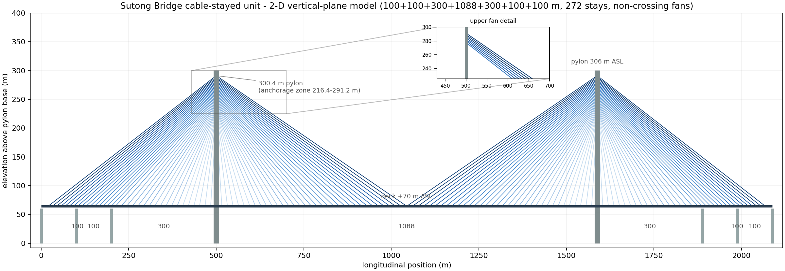

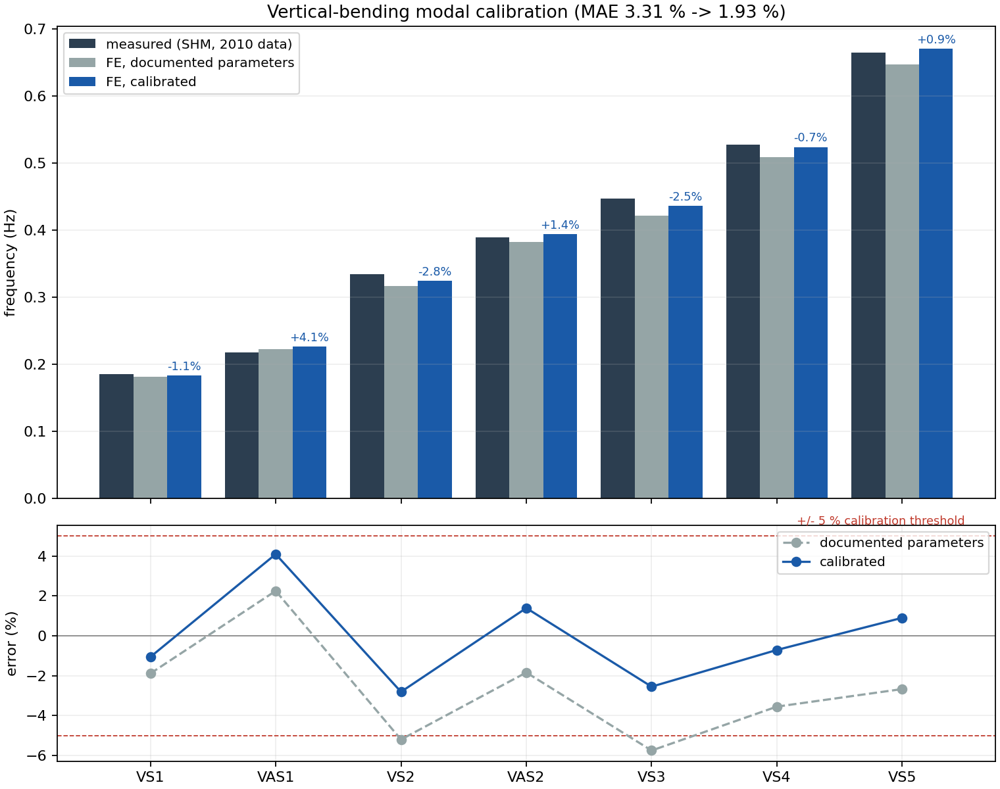

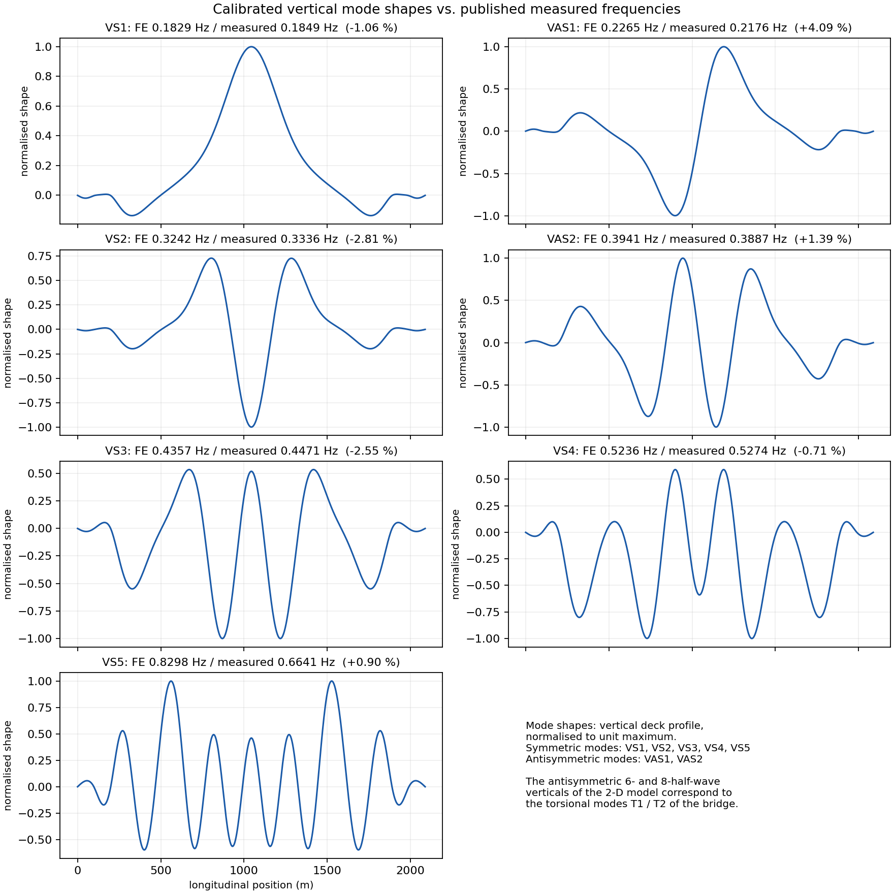

The seven measured vertical modes (VS1, VAS1, VS2, VAS2, VS3, VS4, VS5) pair
one-to-one with the computed symmetric 1, 3, 5, 7, 9 and antisymmetric 2, 4
half-wave modes; the antisymmetric 6- and 8-half-wave verticals of the 2-D
model correspond to the torsional modes T1 / T2 of the real bridge and are
excluded from the vertical pairing by construction.

## Stage 2: the regenerated 37-scenario dataset

The scenario dataset was regenerated from this model. Every scenario - the
healthy state included - passes through the *same* chain of solvers:
calibrated geometry, damage applied to element properties, the post-damage
dead-load equilibrium with the manufactured pre-strains and the as-built
Ernst moduli held fixed (one exact linear solve), the linearised
eigen-problem truncated at 12 Hz, modal-superposition simulation with 2 %
modal damping, and the 64-channel measurement subset with white sensor
noise. Three independent 60 s records at 200 Hz are generated per scenario,

* each record from its own seeded turbulent wind field (Kaimal / Panofsky
  spectra with spanwise coherence) and its own Poisson traffic stream
  (cars and three-axle trucks in both directions);
* no two records in the dataset share an excitation realisation: the
  mid-span channel correlation between records is 0.04 +/- 0.05 with no
  near-duplicate pair (records that shared one excitation would correlate
  at exactly 1.000);
* the only systematic difference between scenarios is the damage state.

The 37 scenarios are the healthy state plus twelve damage families at three
severity levels (5 / 15 / 35 % property loss, 3 / 10 / 25 % for the combined
families): stay degradation (single, symmetric pair, fan-end set), girder
bending loss (mid-span, quarter point, pylon anchors), pylon base and
upper-column degradation, bearing stiffness loss (transition and auxiliary
piers), and two combined families. Damage is applied to exactly the
elements the family describes - the driver verifies that the documented
damage and the applied damage are the same thing element by element.

Two boundary-condition families of the original study act on restraints
that cannot exist in a vertical plane (transverse bearing restraint,
pylon-top rotational restraint); they are reinterpreted on the in-plane
stiffness those substructures actually provide here, and the scenario
catalogue states this explicitly.

The full verification record is written to
`results/scenario_report.md` by `scripts/run_scenarios.py`; 19 automated
checks and the 15 new simulation unit tests all pass. Highlights:

| quantity | result |
|---|---|
| scenarios | 37 = healthy + 12 families x 3 severities, generated deterministically |
| post-damage equilibrium residual | 7e-11 |
| minimum stay force after any damage | 3.31 MN (no slack cable) |
| maximum stay stress ratio after severe damage | 0.433 fu (overload of the neighbouring stays) |
| frequency response | monotone in severity for all 12 families; severe scenarios shift the seven verticals by -0.49 % on average |
| resonant rise of the 7 verticals in a healthy record | 34..1722 x local background |
| excitation independence | 111 unique seeds; mean pairwise record correlation +0.037 +/- 0.045 (2 SE) |
| record rms band | 1.0 - 1.3 mg across all 111 records |

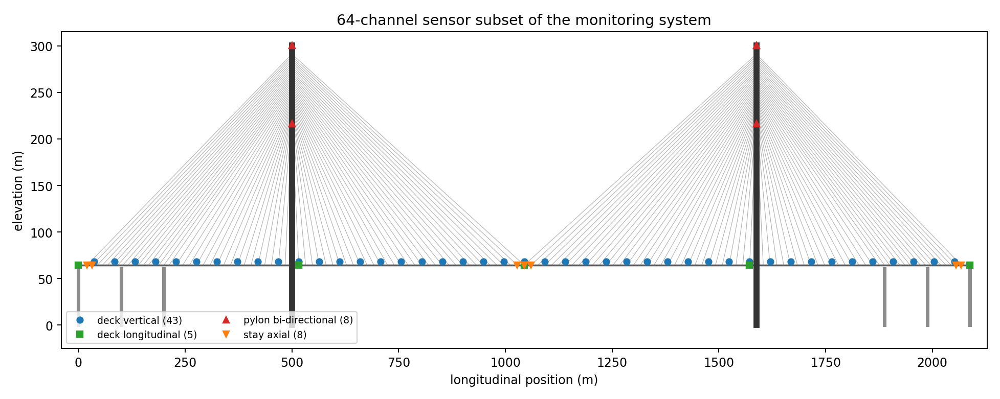

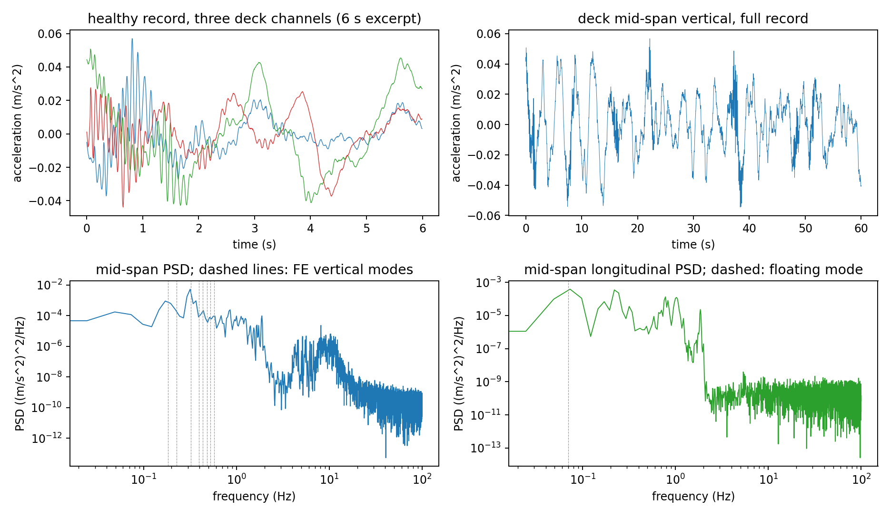

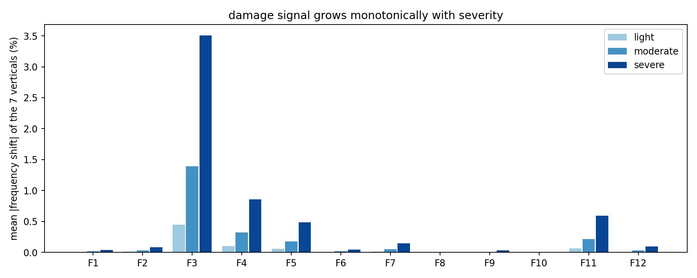

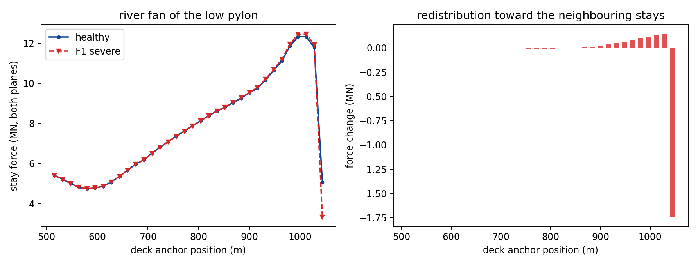

The records (~9 MB per scenario, 302 MB in total) live in
`data/scenario_records/` as one compressed `.npz` per scenario - the
acceleration matrix (3 x 64 x 12000 float32, m/s^2, sensor noise included),
the excitation seeds and the channel layout. They are excluded from the
git-tracked source (`.gitignore`) to keep the repository light, and can be
regenerated bit-for-bit with `scripts/run_scenarios.py` (~4.5 minutes); the
Zenodo / release archive carries the full dataset.

## Stage 3: damage-sensitive feature extraction

Every 20 s window of every record is transformed into the 387-dimensional
feature vector of the study (`sutong_fe/features.py`,
`scripts/run_features.py`):

| family | dim | definition |
|---|---|---|
| CWT band energies | 320 | complex Morlet CWT (w0 = 6, 50 log-spaced scales over 0.05-10 Hz), energy integrated over five bands (0.05-0.2 / 0.2-0.5 / 0.5-1 / 1-2 / 2-10 Hz) per channel |
| Hilbert envelope decay | 64 | least-squares slope of the log envelope of the analytic signal, per channel |
| SVD entropy | 1 | Shannon entropy of the normalised squared singular values of the window response matrix |
| cross-spectral phase deviation | 1 | mean over the adjacent deck-vertical sensor pairs of the std-dev of the cross-spectral phase over 0.1-2 Hz |
| modal-amplitude ratio | 1 | blindly identified mode-1 / mode-2 amplitude at deck mid-span (frequency-domain decomposition) |

The 111 records of the dataset yield 333 labelled window samples
(`data/features/features_windows.npz`), the training material of the
learning stage. The driver also runs the three blind identification
engines (FDD, SSI-COV, p-LSCF) on the healthy records and tabulates them
against the calibrated FE frequencies:

| method | verticals identified within 2.5 % of the FE reference |
|---|---|
| SSI-COV | 7 of 7 |
| FDD | 5 of 7 |
| p-LSCF | 0 of 7 (no stable poles on 60 s records) |

The p-LSCF outcome is the expected one for records of this length and is
reported as measured. The full record - 13 automated checks including a
bitwise recomputation of one window - is in
`results/feature_report.md`; the data figures of the study
(figs 10-16: healthy PSD, CWT scalogram, band-energy violins, damage
inventory, severity shifts, representative time series) are regenerated
from the actual records in the same pass.

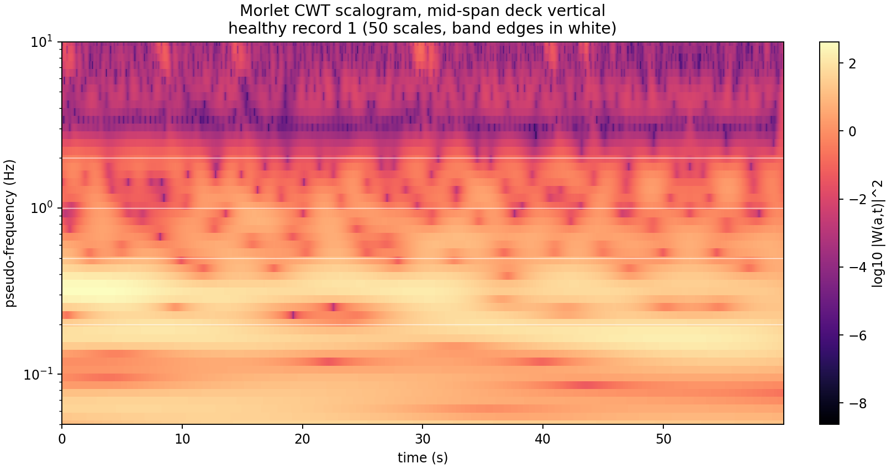

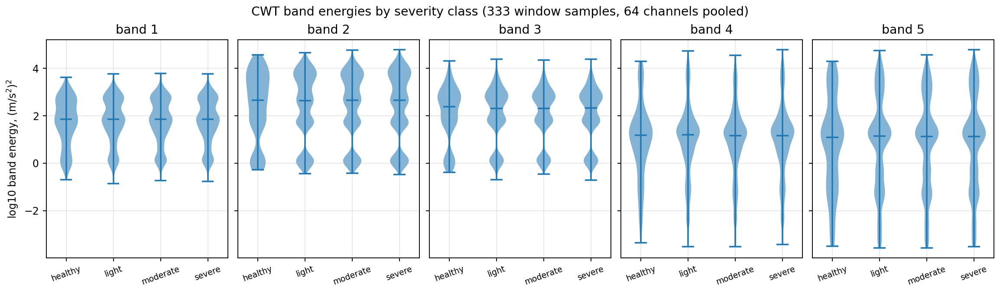

## Stage 4: the learning pipeline

The PI-DL network of the study (`sutong_fe/learning.py`,
`scripts/run_learning.py`) combines a per-channel 1D-CNN over the 5-band CWT
tensor, two message-passing layers over the exponential-kernel sensor graph
(sigma_d = 624 m, the median pairwise sensor distance), and a fully
connected evidential head with a Dirichlet prior over the four severity
classes. All 387 features enter the model - the 320 CWT energies through
the CNN / GNN path, the 64 Hilbert decays and the 3 scalars through the
head input.

Two properties of the implementation matter for reproducibility:

* **the corrected evidential loss.** The KL regulariser is evaluated on
  alpha-tilde = y + (1 - y) * alpha - the Sensoy true-class evidence
  removal - and its weight is annealed over the first ten epochs. An
  uncorrected constant-lambda variant pins the total evidence near zero,
  the uncertainty saturates at u ~ 0.91 on *every* input, and the head
  degenerates to a near-uniform constant output; the automated checks of
  the driver verify the corrected behaviour explicitly.
* **the scenario-level cross-validation.** 5 GroupKFold folds over the 13
  damage groups (the healthy state plus the 12 families), 3 seeds per
  fold, 15 training runs; every window of every record of a scenario stays
  in one fold, and the feature standardisation of every fold is fitted on
  the training windows only. Each run trains over the fixed 120-epoch
  budget of the protocol; the reported metrics are taken at each run's
  best epoch (validation accuracy, ECE tie-break).

The same folds, seeds and standardised features feed five baselines
(SVM, Random Forest, 1D-CNN, LSTM, Transformer) and four ablations
(no-GNN, no-CWT, no-scalars, no-evidential) implemented by actually
removing the corresponding module. The 15 fold-seed state dicts and the
fold scalers are exported to `results/trained_models/`.

Measured over the 15-run protocol (regenerated by every run of the driver,
see `results/learning_report.md`):

| model | accuracy (15 runs) |
|---|---|
| PI-DL (evidential) | 44.0 % +/- 7.5 % |
| LSTM baseline | 43.8 % +/- 7.7 % |
| 1D-CNN baseline | 43.3 % +/- 9.0 % |
| Transformer baseline | 42.7 % +/- 6.1 % |
| SVM (RBF) | 39.9 % +/- 9.7 % |
| Random Forest | 38.7 % +/- 8.7 % |

Ablations, implemented by actually removing the module
(`results/ablation.csv`):

| variant | accuracy (15 runs) | mean u | parameters |
|---|---|---|---|
| full PI-DL | 44.0 % +/- 7.5 % | 0.85 | 73,348 |
| no GNN | 42.1 % +/- 5.8 % | 0.75 | 137,316 |
| no CWT | 38.6 % +/- 4.3 % | 0.71 | 4,612 |
| no scalars | 46.1 % +/- 7.2 % | 0.91 | 69,060 |
| no evidential (softmax CE) | 44.5 % +/- 6.7 % | - | 73,348 |

Removing the CWT tensor costs the most accuracy (38.6 %); dropping the
three scalar inputs lands slightly ahead of the full model but well
inside one standard deviation, so the honest read is that the severity
signal of this feature set lives in the band energies, and the two input
paths are redundant rather than complementary on the leave-family-out
task.

The honest outcome of the leave-family-out protocol is reported as
measured: damage *detection* transfers across families (a logistic probe
on the same folds separates healthy from damaged at 100 % on every fold
that contains the healthy class), while severity *grading* on unseen
damage families sits near chance for every model in the comparison - the
severity response of the absolute-energy features (a 0.05 log10-unit
shift at the severe level) is of the same order as the record-to-record
excitation spread (0.04-0.06 log10 units). The automated checks assert
mechanical correctness (no scenario in both splits, leakage-free
standardisation, identical fold/seed protocol for every model,
deterministic retraining), not outcome superiority.

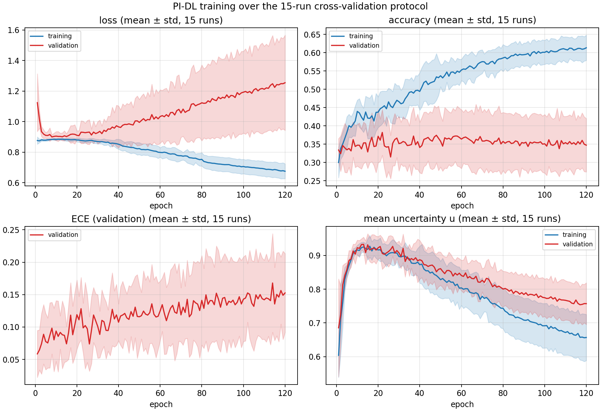

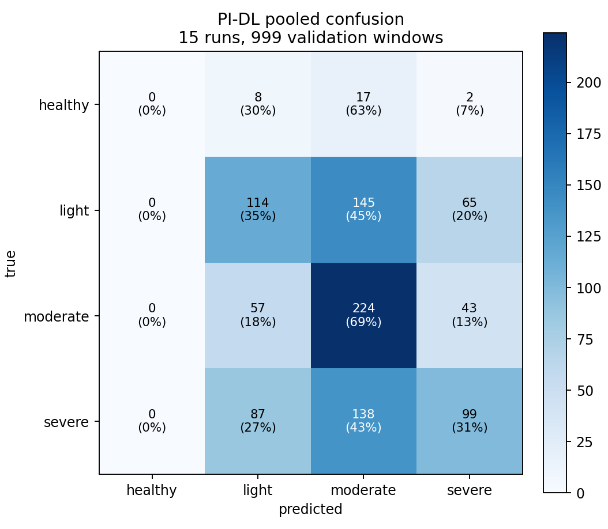

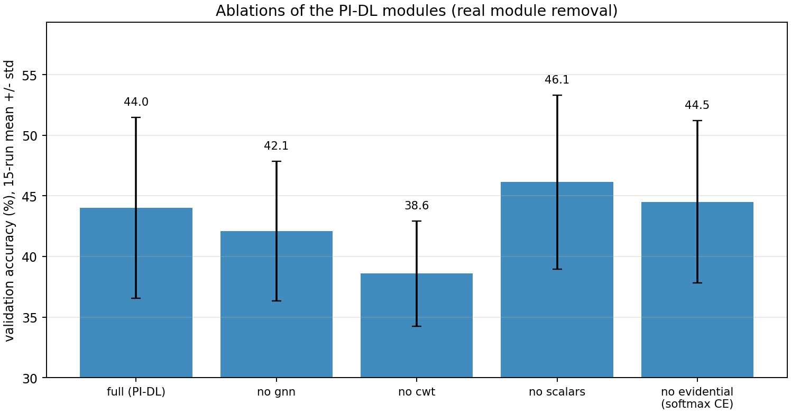

## Quickstart

```bash
pip install -r requirements.txt

python scripts/run_stage1.py        # stage 1: build -> shape-find ->
                                    # calibrate -> verify -> export (~3 min)
python scripts/run_scenarios.py     # stage 2: all 37 scenarios, 3 records
                                    # each, plus verification (~5 min)
python scripts/run_features.py      # stage 3: 333-window feature matrix,
                                    # blind modal ID, data figures (~6 min)
python scripts/run_learning.py      # stage 4: 15-run PI-DL protocol,
                                    # baselines, ablations (~40 min;
                                    # checkpointed, resumable)
python scripts/run_checks.py        # unit-test suite, stages 1 + 2 (~20 s)
```

Outputs land in `results/` (CSV tables, figures, `summary.json`,
`verification_report.md`, `scenario_report.md`, `feature_report.md`,
`learning_report.md`), in `data/scenario_records/` (the records) and in
`data/features/` (the window feature matrix).
`results/calibration_result.json` stores the updating factors so the
scenario stage reuses the calibrated model directly. `--quick` flags run a
smoke-sized subset.

## Repository layout

```
sutong_fe/            FE + analysis package
  params.py           every parameter, with its source
  geometry.py         node / element / stay topology (generated, not typed)
  elements.py         beam and stay-cable element matrices, Ernst modulus
  model.py            assembly, shape finding, serviceability checks
  modal.py            eigen-solution and automatic mode classification
  calibration.py      bounded updating against the measured modes
  scenarios.py        the 37-scenario catalogue and damage application
  sensors.py          64-channel monitoring subset and measurement operator
  excitation.py       seeded turbulent wind + Poisson traffic stream
  simulate.py         modal-superposition record simulation
  features.py         CWT / Hilbert / SVD / phase / modal-ratio features
  learning.py         PI-DL network, evidential loss, CV protocol
scripts/
  run_stage1.py       stage-1 driver (full pipeline + exports)
  run_scenarios.py    stage-2 driver (37 scenarios + verification + exports)
  run_features.py     stage-3 driver (features + modal ID + data figures)
  run_learning.py     stage-4 driver (15-run protocol + tables + figures)
  run_checks.py       test-suite runner (pytest optional)
tests/                topology / statics / modal / scenario / simulation tests
docs/
  parameter_sources.md   parameter-to-source mapping
results/              generated artefacts (committed for reference)
data/scenario_records/  simulated records (regenerable; in the release archive)
data/features/          window feature matrix (regenerable; in the release archive)
```

## Roadmap

The four numerical stages of the study are complete. Natural extensions,
in the order they would strengthen the conclusions:

- a 3-D model with individually modelled stays to push the calibration
  residual below 1 % and capture torsional modes;
- feature normalisation against the excitation realisation (relative band
  energies, per-record whitening) to separate severity grading from
  record-to-record excitation spread;
- a cross-structure transfer probe with a second FE model of a different
  bridge type, to test the out-of-distribution behaviour of the evidential
  head on genuinely different structures;
- retraining on measured records from the installed Sutong SHM system when
  such data become available for research use.

## Sources

The parameter provenance of every value is documented in
`docs/parameter_sources.md`. The principal references:

1. Jiangsu Provincial Department of Transportation, record of the Sutong
   Yangtze River Bridge project (span arrangement, pylon height, clearance).
2. Rao H. R., Deng H. B., "Long-cable erection technology of a
   kilometer-scale cable-stayed bridge" (cable system: 272 stays, 34 levels
   per side, 16 m / 12 m anchorage spacing, PES7 specifications).
3. Zhang X. W., "Key technology and innovation of the Sutong Bridge"
   (pylon segmentation, steel anchor boxes, girder cross-section).
4. Tongji University, structural seismic research report of the Sutong
   Bridge project (design-stage FE properties, boundary conditions, cable
   areas, concept-model modal results).
5. Mao J. X., Gui G., Wang H., Yang Z. Y., "Long-term tracking and
   variability analysis of the modal parameters of a long-span cable-stayed
   bridge", Chinese Journal of Vibration Engineering, 2024, 37(1): 52-59
   (measured modal frequencies and damping used as calibration targets).
6. Yang Z. Y., Mao J. X., Wang H., Zhang Y. M., "Application of the Bayesian
   method in modal-parameter identification of a long-span cable-stayed
   bridge", Chinese Journal of Vibration Engineering, 2022 (independent
   cross-check of the four lowest measured vertical modes).

## License

MIT - see `LICENSE`.
